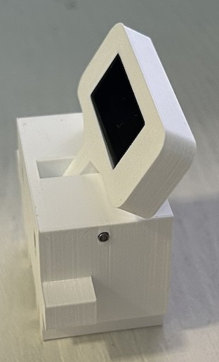
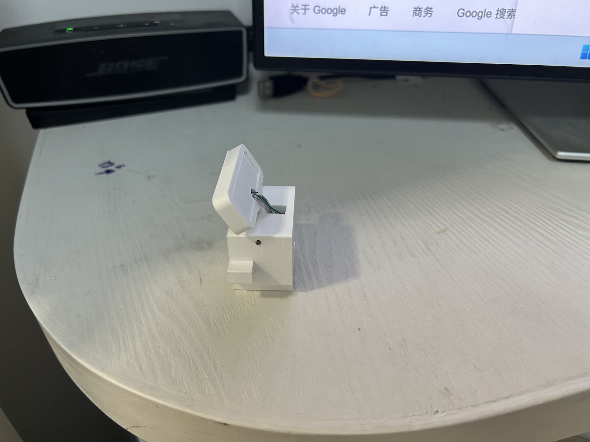

# esp32-ai-usage — 桌面 AI 额度小摆件

一个立在桌面上的claude模型小硬件：**实时显示 Codex / Claude / Kimi / 中转站还剩多少额度**。
写代码前瞄一眼，就知道这个 5 小时窗口还能不能放开用、余额还剩几块钱。
## 它这样工作
Codex / Claude / Kimi 订阅：显示 5 小时和 1 周窗口的剩余百分比、恢复时间：


中转站（API key 计费,支持sub2api和new-api）：显示已用金额和剩余余额：


## 亮点

- **屏幕支撑杆可拨动调节**：屏幕角度随手一拨就换，想立就立、想躺就躺；
  杆子里藏了颗波珠螺丝，拨动时**嘎嗒嘎嗒**的段落感，闲下来还能当解压玩具。

  
  

- **一根 USB 线搞定**：既供电又传数据，小硬件本身不联网、不存任何账号信息。
- **不消耗额度**：电脑端程序读的是本机已登录的 Codex / Claude / Kimi 凭据，
  调用的是客户端内部同款「用量查询」接口——只查询、不跑模型。
- **材料便宜好买**：核心就是一块 ESP32-C3 和一块 0.91 寸 OLED，动手部分只需焊 4 根线。

## 动手做一个（三步）

1. **备料** —— 清单和购买链接见 [docs/材料表.md](docs/材料表.md)
2. **组装** —— 焊线、装拨动杆、装壳，跟着图走：[docs/硬件安装.md](docs/硬件安装.md)
3. **装软件** —— 给 ESP32 刷一次固件 + 电脑上运行 `esp32-ai-usage.exe`：[docs/软件使用.md](docs/软件使用.md)

装好后把它插上电脑 USB，电脑端程序会自动找到它并开始显示。

## 工作原理（一句话版）

```
电脑端程序（读本机已登录的 Codex/Claude/Kimi 凭据，调用官方用量接口）
        │  USB 串口，每 4 秒发一屏
        ▼
ESP32-C3 ──I2C──> OLED 小屏（只负责显示，不联网）
```

想看协议细节的开发者请读 [PROTOCOL.md](PROTOCOL.md)。

## 常见问题

| 现象 | 处理 |
|---|---|
| 屏幕一直 `Waiting for PC...` | 电脑端程序没在跑，或串口没连上（看程序底部状态栏），见[软件使用](docs/软件使用.md) |
| 屏幕不亮 | 检查 OLED 四根线有没有焊对（VCC/GND/SDA/SCL），见[硬件安装](docs/硬件安装.md) |
| 某一页显示 `ERR` | 对应账号没登录、网络不通或端点没配对，见[软件使用](docs/软件使用.md)的常见问题表 |

## 给开发者

- `host/`：电脑端程序，Go + Fyne 桌面界面（Windows；构建方法见 [docs/软件使用.md](docs/软件使用.md)，发 Release 时 GitHub Action 会自动构建 exe）
- `firmware/`：ESP32 固件，PlatformIO + Arduino + U8g2
- `PROTOCOL.md`：电脑端 ↔ ESP32 的串口协议（一行 JSON = 一整屏）

欢迎 PR：支持更多中转站类型、更多板子/屏幕、macOS/Linux 端等。

## 安全提示

`~/.codex/auth.json`、`~/.claude/.credentials.json`、`~/.kimi-code/credentials/kimi-code.json` 等同密码。
本程序只在你的电脑本地读取它们、只用于调用对应的用量查询接口，不打印、不上传 token。
请不要把这些文件（以及 `~/.esp32-ai-usage/config.json`）提交到仓库或分享给别人。
