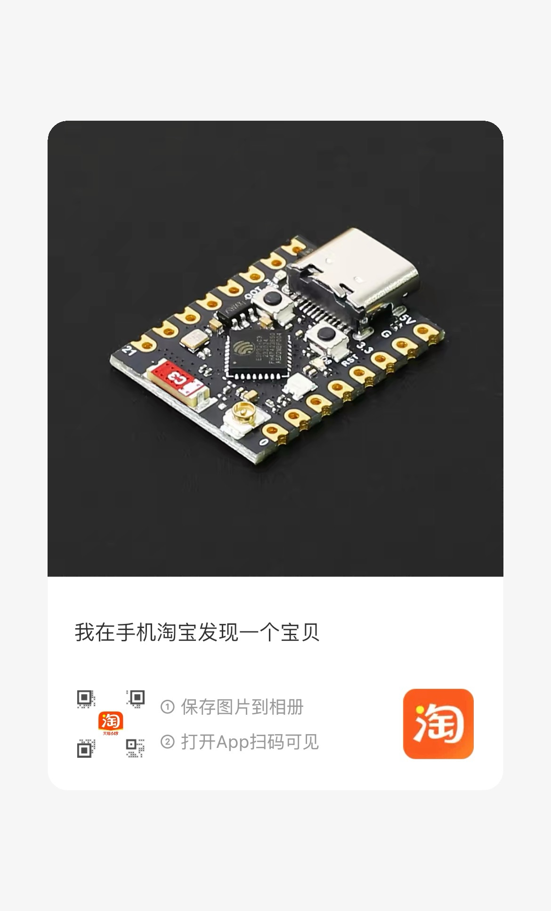
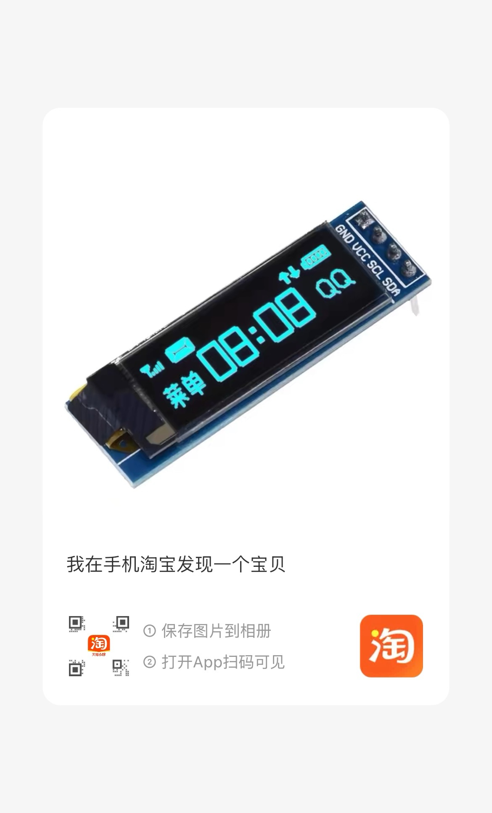
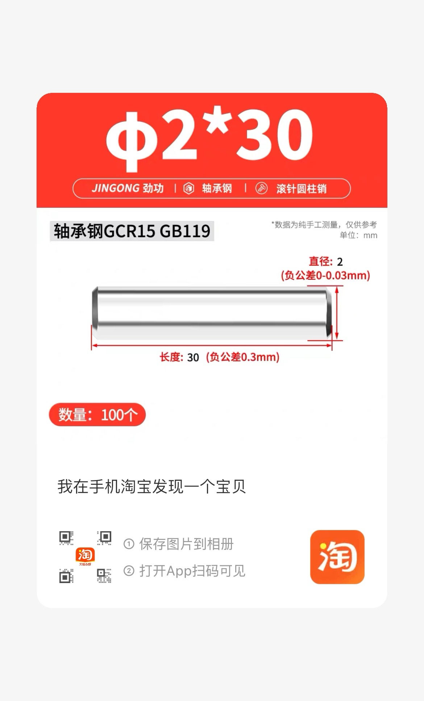
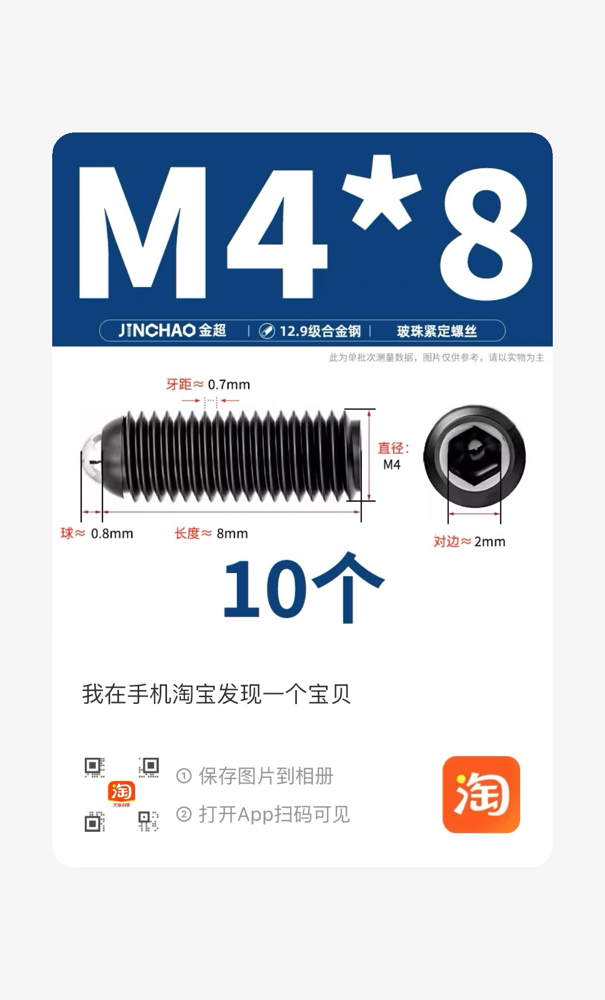
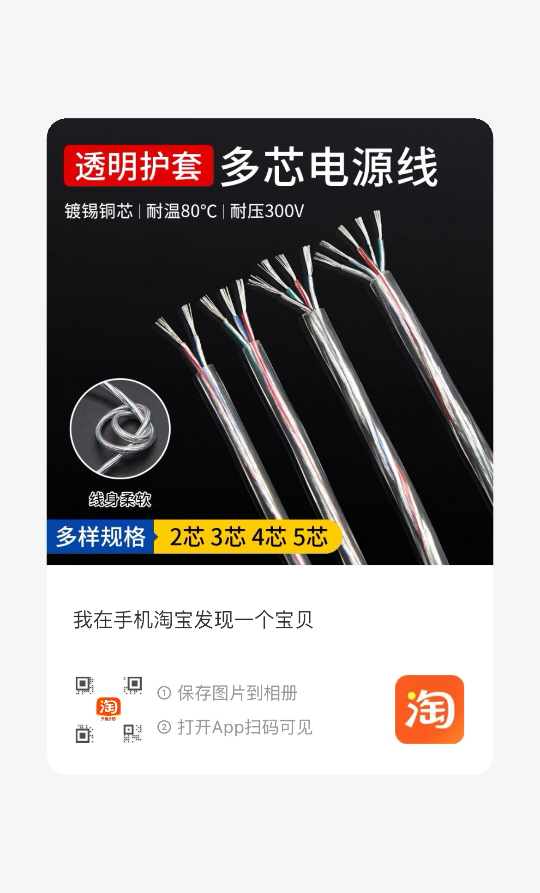

# 材料表
## esp32c3 supermini模块
淘宝链接： https://e.tb.cn/h.RC1b54IfR1OxcUa?tk=y5kRgOyXVCd 

## 显示屏模块
规格: 0.91寸oled显示屏(4pin)
淘宝链接： https://e.tb.cn/h.REEEVpy3dxMgBoe?tk=XN6GgOyVfkw 

## 圆柱棒/圆柱销（固定拨动杆和主体用)
规格: 2mm直径30mm长 
淘宝链接： https://e.tb.cn/h.REDxl5PxTem2MKx?tk=4y8ggOz7Rtr 

## 波珠螺丝(拨动杆拨动嘎嘎响用)
规格: M4*8 
淘宝链接： https://e.tb.cn/h.RwsddgNgJnvsKuQ?tk=cdxCgOygthc 

## 连接线
规格: 28awg 4芯 
淘宝链接： https://e.tb.cn/h.REEwDEovPhZ6OM4?tk=Zk8zgOyf5Kr 
备注：此款需要剥最外套的皮，不然穿不进。连接线可随便购买，只要能穿进就行

