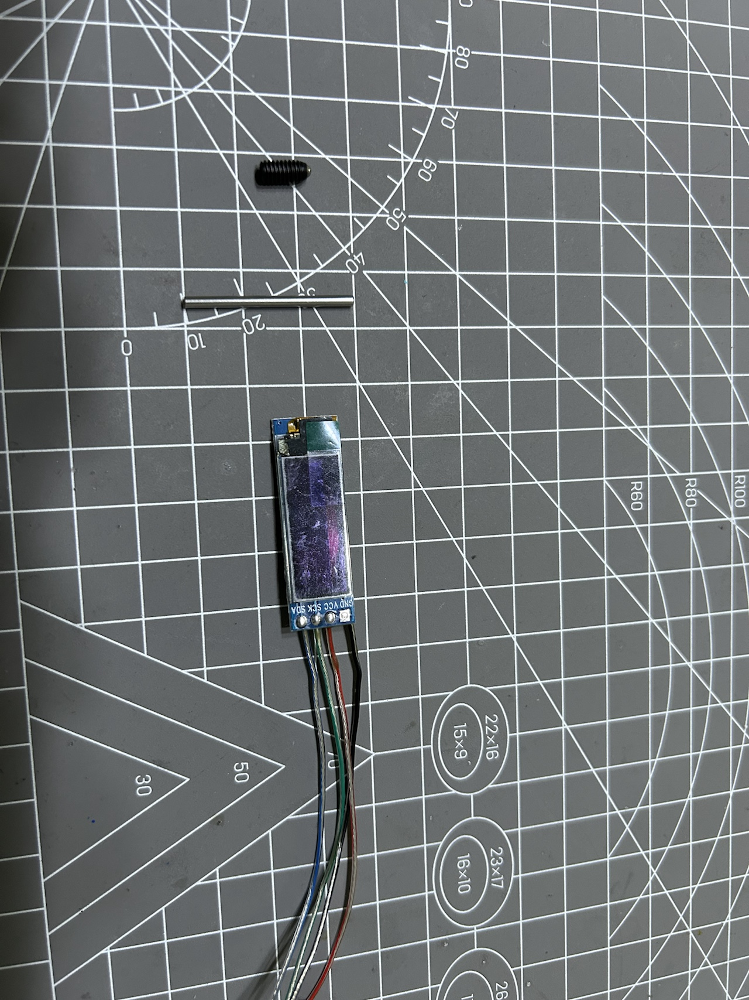
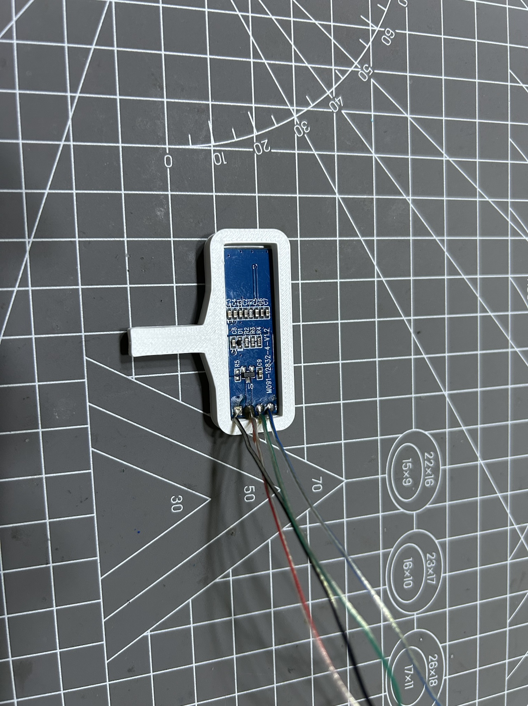
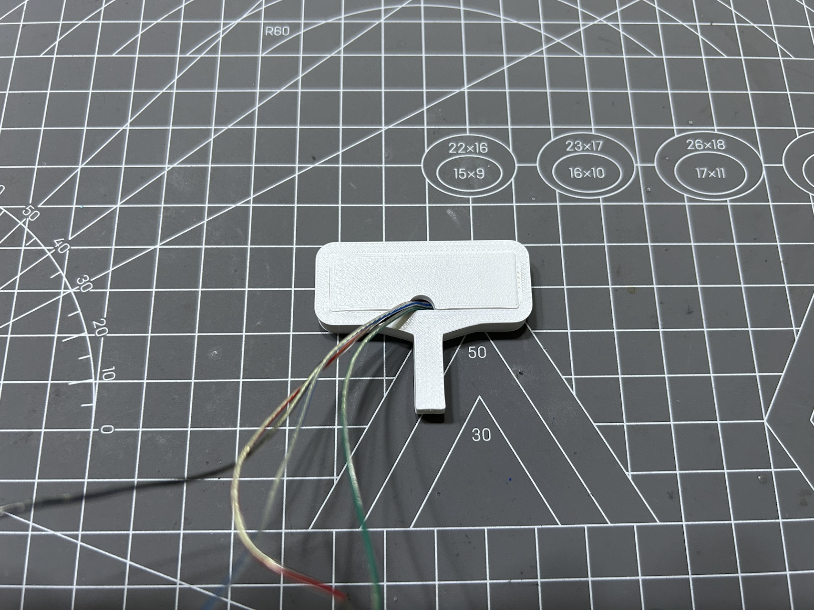
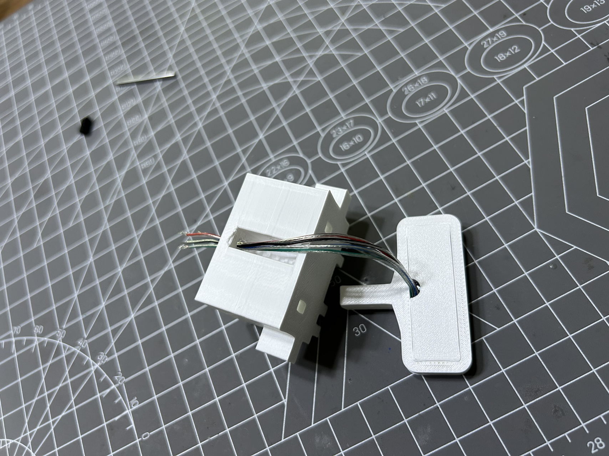
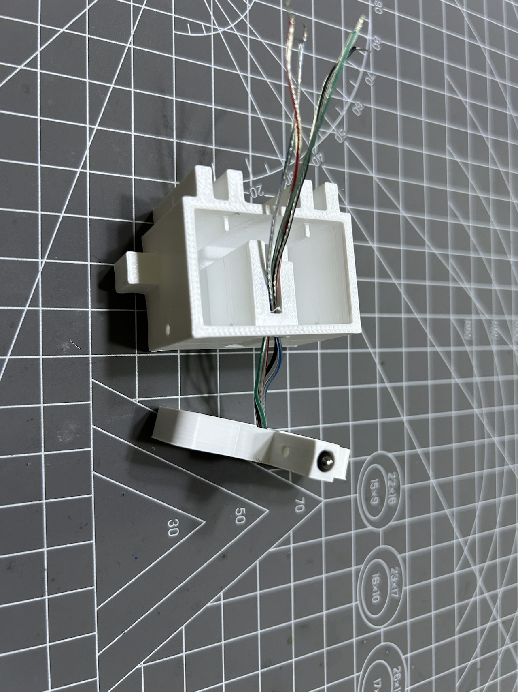
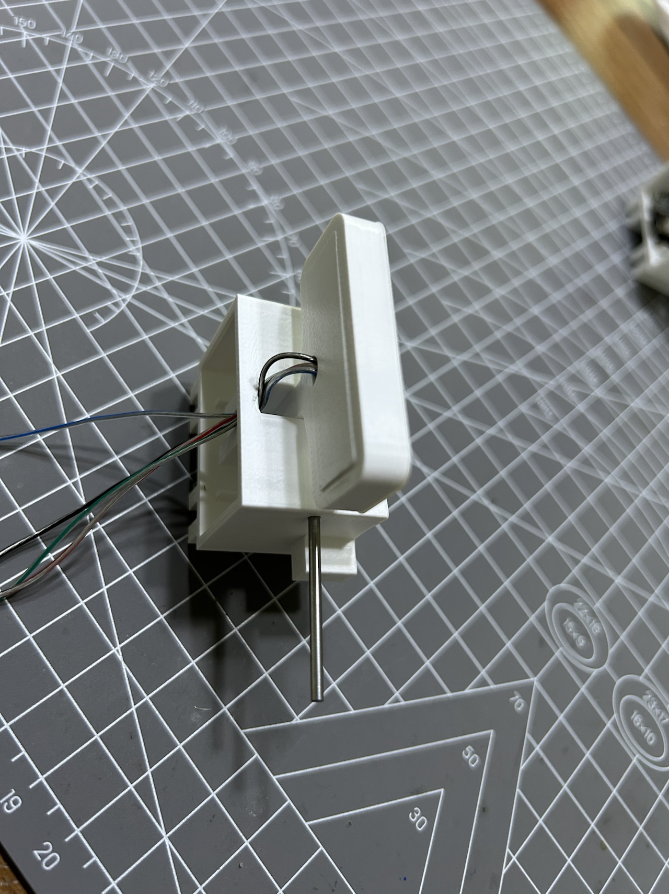
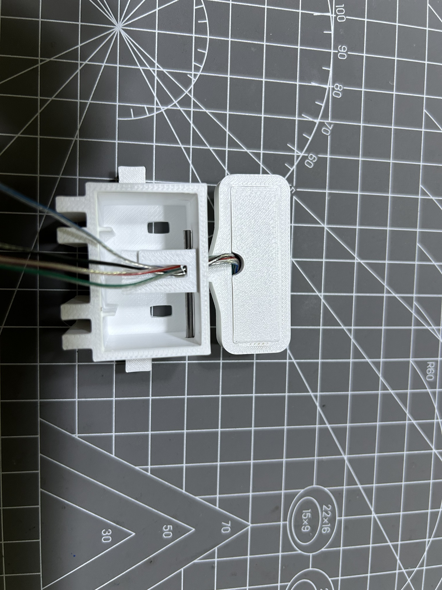
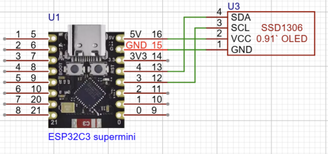
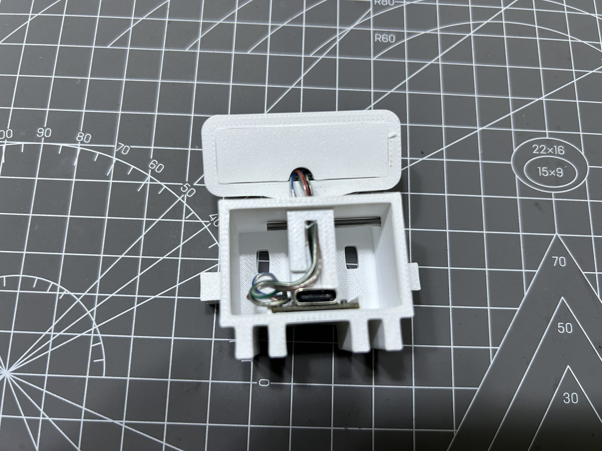
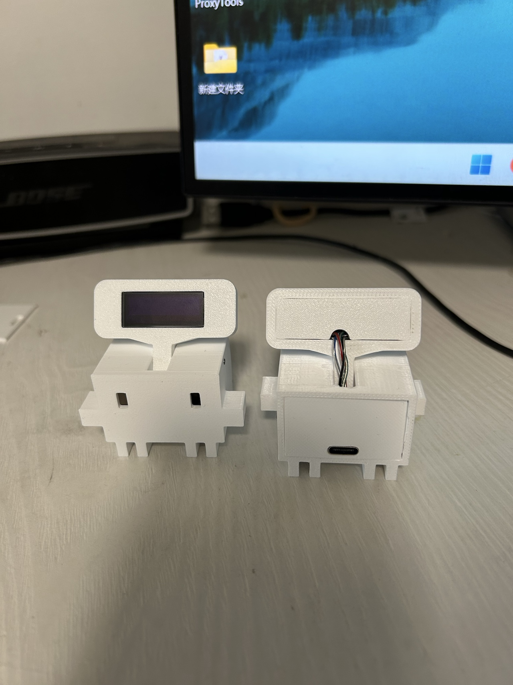

# 硬件安装
[材料表](./材料表.md)
## 安装步骤
### 一，显示屏装入拨动杆
1，显示屏焊接连接线

2，显示屏装入拨动杆槽

3，拨动杆槽后盖安装，后盖孔出连接线

### 二，拨动杆和主体连接
1，连接线穿入主体

2, 拨动杆装入波珠螺丝

3, 拨动杆和主体使用圆柱棒固定

### 三，esp32c3焊接与固定
接线图：

### 四，装入后盖，竣工

