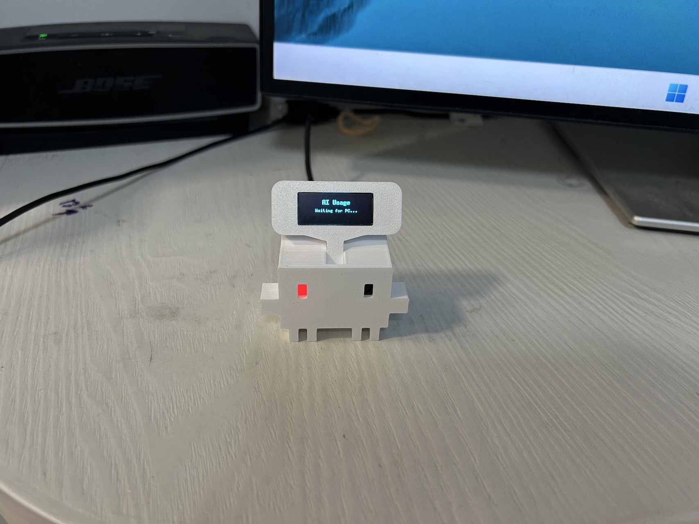
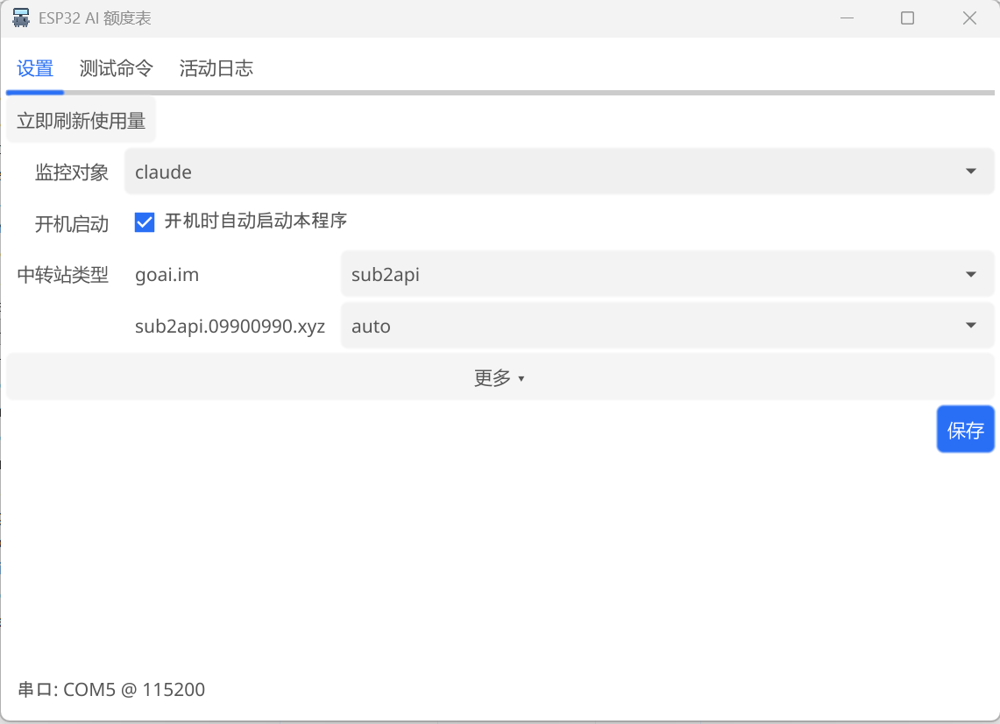
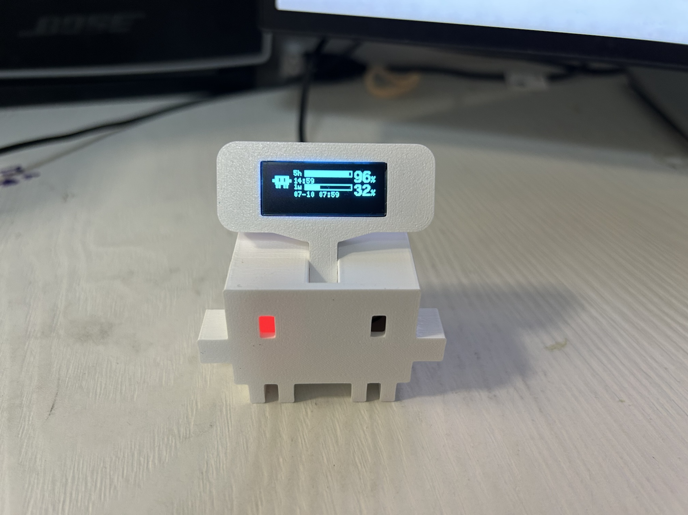
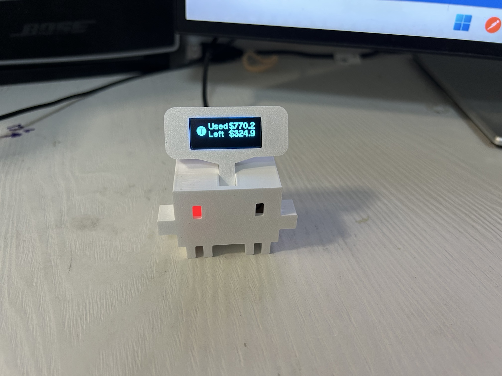

# 软件使用

软件分两部分，都在本仓库里：

| 部分 | 装在哪 | 干什么 |
|---|---|---|
| 固件（`firmware/`） | 刷进 ESP32-C3（只需刷一次） | 在小屏幕上画出画面 |
| 电脑端程序 `esp32-ai-usage.exe`（`host/`） | 装在 Windows 电脑上 | 查询额度，通过 USB 发给小硬件 |

---

## 一、给 ESP32 刷固件（只需一次）

刷固件用 [PlatformIO](https://platformio.org/)。最简单的两种装法（任选其一）：

- 装了 Python 的话：`pip install platformio`
- 或在 VSCode 里装 **PlatformIO IDE** 扩展

步骤：

1. 用 **USB 数据线**（注意别拿成只能充电的线）把 ESP32-C3 连到电脑；
2. 在仓库目录打开命令行，执行：

   ```bash
   cd firmware
   pio run -e esp32-c3 -t upload
   ```

   > 用的是 ESP32-S3 就把 `-e esp32-c3` 换成 `-e esp32-s3`。

3. 刷完屏幕出现 `AI Usage / Waiting for PC...`，固件就绪，等电脑端程序连上来：

   

> 接线说明：固件默认 OLED 接 SDA=GPIO4、SCL=GPIO3（按[硬件安装](./硬件安装.md)接线即可）。
> 如果你接了别的引脚，改 `firmware/platformio.ini` 里的 `-DPIN_SDA` / `-DPIN_SCL` 再刷一次。

---

## 二、电脑端程序 esp32-ai-usage.exe

### 获取

- 直接去本仓库的 **Releases** 页下载 `esp32-ai-usage-*.exe`（推荐）；
- 或自行构建：需要 Go 1.21+ 和 MinGW-w64 gcc，运行 `host/build.bat` 即可，产物在 `host/bin/`。

### 前提

程序**读取本机已登录的 Codex / Claude Code 凭据**去查额度（不跑模型、不消耗额度），
所以电脑上要先正常登录过 Codex（`~/.codex`）或 Claude Code（`~/.claude`），不需要另外填 key。

### 使用
1. 双击运行 `esp32-ai-usage.exe`，弹出设置窗口。
   点右上角关闭只是**收进右下角托盘**，不会退出；托盘图标右键可退出。

2. 在「设置」页确认几项（默认基本可用）：
   - **监控对象**：显示哪个的额度，`codex` / `claude` / `all`（all = 两个轮流翻页显示）；
   - **开机启动**：勾上就随电脑自动启动（默认不勾）；
   - **中转站类型**：用中转站的 Codex 会自动检测出域名，类型一般保持 `auto` 即可，取不到数再手动选 `sub2api` 或 `new-api`；
   - **更多**（点开折叠）：串口默认 `AUTO` 自动找；**用 Claude 的注意**——如果你的 Claude 是走中转的，
     要把「Claude 端点」填成你的中转地址（形如 `https://你的中转域名`），否则 Claude 页会显示 ERR。
3. 点「保存」，把小硬件用 USB 线插上电脑。窗口底部显示「串口: COMx @ 115200」就连上了，
   屏幕随后开始显示额度。想马上看到最新数据，点「立即刷新使用量」。

### 显示效果

Codex / Claude 订阅额度页（5 小时、1 周窗口的剩余百分比和恢复时间）：



中转站页（已用金额 / 剩余余额）：



### 常见问题

| 现象 | 处理 |
|---|---|
| 屏幕一直 `Waiting for PC...` | 确认电脑端程序在运行、底部串口状态已连接；未连接时把「更多」里的串口改成具体的 `COMx` 再保存 |
| 底部显示「串口: 未连接」 | 换根 USB 数据线 / 换个 USB 口，插好后点一次「保存」触发重连 |
| Codex 页显示 `ERR` | 本机没登录 Codex，或访问不了 chatgpt.com（在「更多」里配代理） |
| Claude 页显示 `ERR` | Claude 走中转的话，「Claude 端点」要填你的中转地址（见上文） |
| 中转站页取不到数 | 看「活动日志」里的报错；把「中转站类型」从 `auto` 改成 `sub2api` 或 `new-api` 试试 |
| 数据多久刷新一次 | 默认 5 分钟一次（可在「更多」里改），凭据变动（如切换中转站）会自动立即刷新 |
